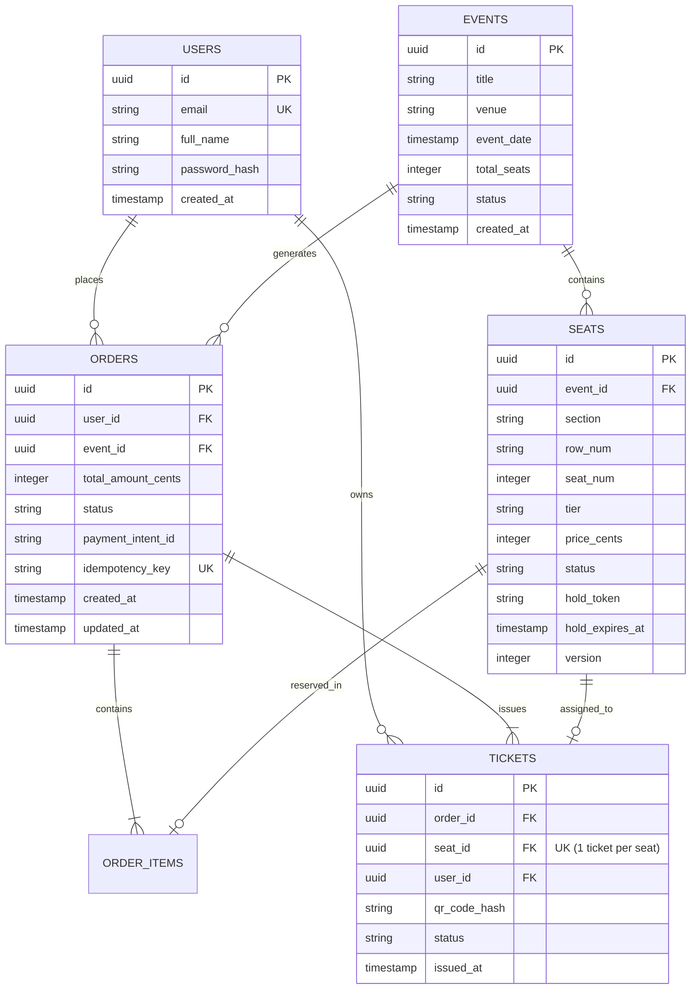

# TicketHub System Design Document: Event Ticketing System

A high-performance, fault-tolerant system design specification for **TicketHub**, an event ticketing platform capable of handling day-to-day operations and surviving massive flash sales when popular concert tickets drop.

---

## 1. Requirements

### Functional Requirements
1. **Browse & Search Events**: Users can search and view upcoming concerts, venues, dates, pricing tiers, and event details.
2. **View Real-Time Seat Availability**: Users can inspect an interactive seat map displaying seat states (`AVAILABLE`, `HELD`, `SOLD`).
3. **Hold Seats Temporarily**: When a user selects available seats, the system places a temporary **10-minute hold** so they can proceed through checkout without someone else stealing the seat.
4. **Checkout & Secure Payment**: Users can complete payment for their held seats within the hold window.
5. **View Purchased Tickets**: Users receive an order confirmation and can view their digital tickets with unique, cryptographically signed QR codes for venue admission.
6. **Automatic Hold Expiration**: If the user abandons the checkout or payment fails, held seats automatically revert to `AVAILABLE` after 10 minutes.

### Non-Functional Requirements
1. **Zero Double-Booking (Strict Correctness & Consistency)**: Under no circumstances can two users buy or hold the exact same seat. Consistency must take precedence over availability for the seat reservation and payment lifecycle (CP under CAP theorem).
2. **Low Latency (Speed)**:
   - Event catalog and seat map lookups must return in under **50 ms** (P95) via edge caching and in-memory caches.
   - Hold requests and checkout submissions must complete in under **1.5 seconds** (P95).
3. **Fairness**:
   - Ticket drops must prevent bots, scalpers, and network advantage from hoarding seats. A First-Come, First-Served (FCFS) virtual waiting room ensures genuine fans get an equal opportunity.
4. **High Availability & Fault Tolerance**:
   - The platform targets **99.99% uptime** under normal operations.
   - During flash sales, the system must degrade gracefully (queue excess traffic rather than crash servers or drop database connections).
5. **Security & Financial Integrity**:
   - PCI-DSS compliant payment processing (delegated entirely to Stripe/payment gateways via client tokens).
   - Idempotent payment webhooks to prevent duplicate charges.

---

## 2. Traffic & Capacity Estimates

### Given Baseline Facts
- **Registered User Base**: 2,000,000 users.
- **Normal Day Traffic**:
  - 50,000 unique daily visitors.
  - Each visitor views an average of 10 pages $\rightarrow 500,000\text{ page views/day}$.
  - 5,000 tickets sold per day.
- **"Big Sale" Flash Traffic**:
  - A mega-popular concert goes on sale.
  - **200,000 people** arrive simultaneously to buy **20,000 seats** within the first **10 minutes** (600 seconds).

---

### A. Normal Day Calculations

#### Reads (Page Views)
- **Daily Page Views**: $50,000 \times 10 = 500,000\text{ views/day}$.
- **Average Read QPS (Queries Per Second)**:
  $$\text{Average Reads/sec} = \frac{500,000\text{ views}}{86,400\text{ seconds}} \approx \mathbf{5.79\text{ reads/sec}}$$
- **Peak Read QPS ($5\times$ daily average)**:
  $$\text{Peak Reads/sec} = 5.79 \times 5 \approx \mathbf{28.95\text{ reads/sec}}\ (\approx 30\text{ QPS})$$

#### Writes (Ticket Purchases)
- **Daily Tickets Sold**: $5,000\text{ tickets/day}$.
- **Average Write QPS**:
  $$\text{Average Writes/sec} = \frac{5,000\text{ tickets}}{86,400\text{ seconds}} \approx \mathbf{0.058\text{ writes/sec}}$$
- **Peak Write QPS ($5\times$ daily average)**:
  $$\text{Peak Writes/sec} = 0.058 \times 5 \approx \mathbf{0.29\text{ writes/sec}}\ (< 1\text{ write/sec})$$

---

### B. "Big Sale" Flash Traffic Calculations (10-Minute Surge)

During the hot concert drop, the entire demand compresses into **10 minutes (600 seconds)**:

#### 1. Reads & Polling During the Big Sale
- 200,000 active users are on the site simultaneously.
- Users actively view the concert page, wait in line, and inspect seat maps.
- Each user's browser polls seat status or queue position every **4 seconds**:
  $$\text{Peak Read QPS} = \frac{200,000\text{ concurrent users}}{4\text{ seconds}} = \mathbf{50,000\text{ reads/sec}}$$
- **Comparison to Normal Day**: Read traffic spikes from **5.79 QPS** to **50,000 QPS**—a **$\approx 8,635\times$ increase**!

#### 2. Writes & Contention During the Big Sale
- **Total Tickets Sold**: 20,000 seats available.
- **Sustained Purchase Rate**:
  $$\text{Sustained Writes/sec} = \frac{20,000\text{ purchases}}{600\text{ seconds}} \approx \mathbf{33.3\text{ successful writes/sec}}$$
- **Contention / Burst Hold Attempts**:
  - The real challenge is **not** the 33.3 successful writes/second; it is the **massive write contention** at the opening bell.
  - All 200,000 eager fans click "Hold / Select Seat" in the first 60 seconds:
    $$\text{Burst Reservation Contention} = \frac{200,000\text{ hold attempts}}{60\text{ seconds}} \approx \mathbf{3,333\text{ write attempts/sec}}$$
  - If 3,333 write attempts per second hit a single relational database trying to lock the same 20,000 rows, database connection pools will exhaust, locks will pile up, and the database will crash.

---

### C. Traffic Comparison Summary

| Metric | Normal Day | Big Sale (Peak) | Scale Factor |
| :--- | :--- | :--- | :--- |
| **Concurrent Users** | $\approx 1,000 - 2,500$ | **200,000** | $\approx 100\times$ |
| **Read Requests** | $5.79\text{ QPS}$ (peak $30\text{ QPS}$) | **$50,000\text{ QPS}$** | **$\approx 8,635\times$** |
| **Completed Purchases** | $0.058\text{ QPS}$ | **$33.3\text{ QPS}$** | $\approx 574\times$ |
| **Write Contention** | Low ($< 1\text{ attempt/sec}$) | **$3,333\text{ attempts/sec}$** | **$\approx 11,000\times$** |
| **Primary Bottleneck** | None (1 server + 1 DB is enough) | **DB Row Contention & Connection Exhaustion** | Mitigated by Queue + Redis |

---

## 3. RESTful API Design

The TicketHub API follows standard REST principles, JSON formatting, appropriate HTTP verbs, and unambiguous HTTP status codes.

### 1. Browse Events
- **Endpoint**: `GET /api/v1/events`
- **Description**: Returns paginated list of upcoming events with filtering options.
- **Query Parameters**: `genre=rock`, `city=NewYork`, `page=1`, `limit=20`.
- **Response**: `200 OK`
```json
{
  "page": 1,
  "limit": 20,
  "total": 45,
  "events": [
    {
      "id": "evt_9872",
      "title": "Cosmic Tour 2026",
      "artist": "Starlight Echoes",
      "venue": "Metro Arena, NY",
      "eventDate": "2026-11-15T20:00:00Z",
      "minPriceCents": 5500,
      "maxPriceCents": 25000,
      "status": "ON_SALE"
    }
  ]
}
```

---

### 2. View Seats for an Event
- **Endpoint**: `GET /api/v1/events/:eventId/seats`
- **Description**: Retrieves real-time seat availability map for an event. Cached in Redis and updated via event streams.
- **Response**: `200 OK`
```json
{
  "eventId": "evt_9872",
  "totalSeats": 20000,
  "availableCount": 4210,
  "seats": [
    {
      "id": "seat_secA_r1_s10",
      "section": "Section A",
      "row": "Row 1",
      "seatNumber": 10,
      "tier": "VIP",
      "priceCents": 25000,
      "status": "AVAILABLE"
    },
    {
      "id": "seat_secA_r1_s11",
      "section": "Section A",
      "row": "Row 1",
      "seatNumber": 11,
      "tier": "VIP",
      "priceCents": 25000,
      "status": "HELD"
    }
  ]
}
```

---

### 3. Hold Selected Seats
- **Endpoint**: `POST /api/v1/seats/hold`
- **Description**: Requests an exclusive temporary hold (10-minute TTL) on 1 to 4 seats. Prevents concurrent claims.
- **Request Body**:
```json
{
  "eventId": "evt_9872",
  "seatIds": ["seat_secA_r1_s10"]
}
```
- **Success Response**: `201 Created`
```json
{
  "holdToken": "hld_4a9b8e21c3d0",
  "eventId": "evt_9872",
  "seatIds": ["seat_secA_r1_s10"],
  "totalPriceCents": 25000,
  "expiresAt": "2026-10-28T13:51:00Z",
  "holdDurationSeconds": 600
}
```
- **Conflict Response (Seat Already Held / Sold)**: `409 Conflict`
```json
{
  "error": "SEAT_UNAVAILABLE",
  "message": "One or more requested seats are currently held or sold.",
  "conflictedSeatIds": ["seat_secA_r1_s10"]
}
```

---

### 4. Checkout and Pay
- **Endpoint**: `POST /api/v1/orders/checkout`
- **Description**: Verifies payment token, commits seat sale, and marks order as `COMPLETED`.
- **Request Body**:
```json
{
  "holdToken": "hld_4a9b8e21c3d0",
  "paymentMethodToken": "pm_tok_visa_4242",
  "idempotencyKey": "idem_8f391b4c-9a28-403d"
}
```
- **Success Response**: `201 Created`
```json
{
  "orderId": "ord_8829104",
  "status": "COMPLETED",
  "eventId": "evt_9872",
  "seatsPurchased": ["seat_secA_r1_s10"],
  "totalAmountPaidCents": 25000,
  "currency": "USD",
  "createdAt": "2026-10-28T13:45:12Z"
}
```
- **Error Responses**:
  - `410 Gone`: Hold token expired before checkout was initiated.
  - `402 Payment Required`: Card declined or payment authentication failed.

---

### 5. View User Tickets
- **Endpoint**: `GET /api/v1/users/me/tickets`
- **Description**: Retrieves all confirmed tickets owned by the authenticated user.
- **Response**: `200 OK`
```json
{
  "tickets": [
    {
      "ticketId": "tkt_10928374",
      "orderId": "ord_8829104",
      "eventTitle": "Cosmic Tour 2026",
      "venue": "Metro Arena, NY",
      "eventDate": "2026-11-15T20:00:00Z",
      "seat": {
        "section": "Section A",
        "row": "Row 1",
        "seatNumber": 10
      },
      "qrCodePayload": "signed_jwt_eyJuYW1lIjoiQWxpY2UiLCJ0a3RJZCI6InRrdF8xMDkyODM3NCJ9",
      "status": "VALID"
    }
  ]
}
```

---

### 6. Release Held Seats (User Abandonment)
- **Endpoint**: `DELETE /api/v1/seats/hold/:holdToken`
- **Description**: Explicitly cancels a hold before the 10-minute expiration so other fans can immediately pick the seats.
- **Response**: `204 No Content`

---

## 4. Relational Data Model

A relational database (PostgreSQL) is mandatory to guarantee strict ACID transactions for seat inventory and financial purchases.

### Entity Relationship Diagram (ERD)



---

### SQL Table Definitions (PostgreSQL Dialect)

```sql
-- 1. Users Table
CREATE TABLE users (
    id UUID PRIMARY KEY DEFAULT gen_random_uuid(),
    email VARCHAR(255) NOT NULL UNIQUE,
    full_name VARCHAR(150) NOT NULL,
    password_hash VARCHAR(255) NOT NULL,
    created_at TIMESTAMP WITH TIME ZONE DEFAULT CURRENT_TIMESTAMP
);

-- 2. Events Table
CREATE TABLE events (
    id UUID PRIMARY KEY DEFAULT gen_random_uuid(),
    title VARCHAR(200) NOT NULL,
    venue VARCHAR(200) NOT NULL,
    event_date TIMESTAMP WITH TIME ZONE NOT NULL,
    total_seats INTEGER NOT NULL CHECK (total_seats > 0),
    status VARCHAR(30) NOT NULL DEFAULT 'UPCOMING' CHECK (status IN ('UPCOMING', 'ON_SALE', 'SOLD_OUT', 'CANCELLED')),
    created_at TIMESTAMP WITH TIME ZONE DEFAULT CURRENT_TIMESTAMP
);

-- 3. Seats Table
CREATE TABLE seats (
    id UUID PRIMARY KEY DEFAULT gen_random_uuid(),
    event_id UUID NOT NULL REFERENCES events(id) ON DELETE CASCADE,
    section VARCHAR(50) NOT NULL,
    row_num VARCHAR(20) NOT NULL,
    seat_num INTEGER NOT NULL,
    tier VARCHAR(50) NOT NULL DEFAULT 'STANDARD',
    price_cents INTEGER NOT NULL CHECK (price_cents > 0),
    status VARCHAR(20) NOT NULL DEFAULT 'AVAILABLE' CHECK (status IN ('AVAILABLE', 'HELD', 'SOLD')),
    hold_token VARCHAR(64) DEFAULT NULL,
    hold_expires_at TIMESTAMP WITH TIME ZONE DEFAULT NULL,
    version INTEGER NOT NULL DEFAULT 1, -- Optimistic concurrency control
    created_at TIMESTAMP WITH TIME ZONE DEFAULT CURRENT_TIMESTAMP,

    -- Constraint: No duplicate physical seats within the same event
    CONSTRAINT uq_event_seat UNIQUE (event_id, section, row_num, seat_num)
);

-- Indexes for lightning-fast seat lookups
CREATE INDEX idx_seats_event_status ON seats(event_id, status);
CREATE INDEX idx_seats_hold_token ON seats(hold_token);
CREATE INDEX idx_seats_hold_expiry ON seats(status, hold_expires_at) WHERE status = 'HELD';

-- 4. Orders Table
CREATE TABLE orders (
    id UUID PRIMARY KEY DEFAULT gen_random_uuid(),
    user_id UUID NOT NULL REFERENCES users(id) ON DELETE RESTRICT,
    event_id UUID NOT NULL REFERENCES events(id) ON DELETE RESTRICT,
    total_amount_cents INTEGER NOT NULL CHECK (total_amount_cents >= 0),
    status VARCHAR(30) NOT NULL DEFAULT 'PENDING' CHECK (status IN ('PENDING', 'COMPLETED', 'FAILED', 'EXPIRED')),
    payment_intent_id VARCHAR(100),
    idempotency_key VARCHAR(100) UNIQUE,
    created_at TIMESTAMP WITH TIME ZONE DEFAULT CURRENT_TIMESTAMP,
    updated_at TIMESTAMP WITH TIME ZONE DEFAULT CURRENT_TIMESTAMP
);

CREATE INDEX idx_orders_user ON orders(user_id);

-- 5. Tickets Table (Physical fulfillment record)
CREATE TABLE tickets (
    id UUID PRIMARY KEY DEFAULT gen_random_uuid(),
    order_id UUID NOT NULL REFERENCES orders(id) ON DELETE RESTRICT,
    seat_id UUID NOT NULL REFERENCES seats(id) ON DELETE RESTRICT,
    user_id UUID NOT NULL REFERENCES users(id) ON DELETE RESTRICT,
    qr_code_hash VARCHAR(255) NOT NULL UNIQUE,
    status VARCHAR(20) NOT NULL DEFAULT 'VALID' CHECK (status IN ('VALID', 'USED', 'REVOKED')),
    issued_at TIMESTAMP WITH TIME ZONE DEFAULT CURRENT_TIMESTAMP,

    -- Critical Constraint: Guarantee that one seat can NEVER produce more than one active ticket
    CONSTRAINT uq_ticket_seat UNIQUE (seat_id)
);
```

---

## 5. Prevention of Double-Booking: The Exact Concurrency Mechanism

The most critical engineering requirement of TicketHub is **preventing double-booking**—ensuring two fans clicking on Seat 4B at the exact same millisecond can never both acquire it.

TicketHub solves this using a **3-Layer Defense-in-Depth Concurrency Strategy**:

```
[Layer 1: Redis Distributed Lock with 10-Min TTL]
                  ↓
[Layer 2: Database ACID Atomic Row Update (Optimistic Concurrency)]
                  ↓
[Layer 3: Relational Database Unique Constraint (seat_id)]
```

### Layer 1: Redis Distributed Fast-Lock (Memory Shield)
When a request arrives to hold Seat `seat_secA_r1_s10`, before making any database queries, the application server attempts an atomic Redis `SET` command with an NX (only set if Not eXists) flag:
```redis
SET lock:seat:seat_secA_r1_s10 "hld_4a9b8e21c3d0" NX PX 600000
```
- `NX`: Guarantees only the first command sets the key; any concurrent attempt fails immediately in **< 1 ms**.
- `PX 600000`: Sets an automatic 10-minute (600,000 ms) time-to-live.
- If Redis returns `NULL`, the application server immediately returns `409 Conflict ("Seat is currently held")` without touching the relational database.

### Layer 2: Atomic Database Hold with Optimistic Concurrency Control
Once the Redis lock is claimed, the application executes an atomic SQL update against PostgreSQL:
```sql
UPDATE seats
SET 
    status = 'HELD',
    hold_token = 'hld_4a9b8e21c3d0',
    hold_expires_at = NOW() + INTERVAL '10 minutes',
    version = version + 1
WHERE id = 'seat_secA_r1_s10'
  AND (status = 'AVAILABLE' OR (status = 'HELD' AND hold_expires_at < NOW()))
  AND version = 1;
```
- **Why this prevents race conditions**:
  1. The `WHERE` clause strictly requires `status = 'AVAILABLE'` (or an expired hold) and matches the expected `version`.
  2. PostgreSQL acquires an exclusive row-level write lock during this `UPDATE`.
  3. If another transaction changed the row first, `UPDATE` affects `0 rows`.
  4. If `rows_affected == 0`, the transaction rolls back, releases the Redis key, and returns `409 Conflict`.

### Layer 3: Finalizing Payment in a Strict ACID Transaction
When the user submits checkout with `holdToken = 'hld_4a9b8e21c3d0'`:
```sql
BEGIN TRANSACTION ISOLATION LEVEL READ COMMITTED;

-- 1. Validate that the hold is still active and belongs to this token
SELECT id, price_cents FROM seats
WHERE id = 'seat_secA_r1_s10' 
  AND hold_token = 'hld_4a9b8e21c3d0' 
  AND hold_expires_at > NOW()
FOR UPDATE; -- Locks the row until commit

-- 2. Mark seat as permanently SOLD
UPDATE seats 
SET status = 'SOLD', hold_token = NULL, hold_expires_at = NULL, version = version + 1
WHERE id = 'seat_secA_r1_s10';

-- 3. Insert confirmed Order and Ticket records
INSERT INTO orders (id, user_id, event_id, total_amount_cents, status, idempotency_key)
VALUES ('ord_8829104', 'usr_1', 'evt_9872', 25000, 'COMPLETED', 'idem_8f391b4c-9a28-403d');

INSERT INTO tickets (id, order_id, seat_id, user_id, qr_code_hash, status)
VALUES ('tkt_10928374', 'ord_8829104', 'seat_secA_r1_s10', 'usr_1', 'qr_hash_xyz', 'VALID');

COMMIT;
```
- Because of `CONSTRAINT uq_ticket_seat UNIQUE (seat_id)`, if any software defect attempted to issue a second ticket for the same seat, PostgreSQL aborts the entire transaction with a unique constraint violation.
- Double-booking is mathematically impossible.

### Handling Expired Holds
If the 10-minute hold window elapses:
1. Redis automatically drops the key via its TTL.
2. An async background worker runs every 15 seconds to sweep abandoned seats:
```sql
UPDATE seats
SET status = 'AVAILABLE', hold_token = NULL, hold_expires_at = NULL, version = version + 1
WHERE status = 'HELD' AND hold_expires_at < NOW();
```
3. The released seats trigger a WebSocket broadcast updating the frontend seat map to green (`AVAILABLE`).

---

## 6. Scaled System Architecture: Surviving the Big Sale

When 200,000 users arrive at once, an unshielded database would collapse within seconds. The scaled architecture employs edge buffering, rate limiting, and an asynchronous queueing system.

### Architecture Diagram

```mermaid
flowchart TD
    subgraph Clients["200,000 Concurrent Users"]
        U1[Browser / Mobile App]
        U2[Browser / Mobile App]
        U3[Browser / Mobile App]
    end

    subgraph Edge["Edge Layer (Cloudflare)"]
        CDN[Edge CDN: Static Assets & Event Pages]
        WAF[WAF & DDoS Protection / Bot Blocker]
        VR[Virtual Waiting Room / Queue]
    end

    subgraph Ingress["Ingress & Routing"]
        ALB[Application Load Balancer]
    end

    subgraph AppCluster["Stateless Application Cluster"]
        AS1[App Server 1]
        AS2[App Server 2]
        AS3[App Server 3]
        AS4[App Server N (Auto-scaled)]
    end

    subgraph CacheCluster["In-Memory Cache & Lock (Redis)"]
        RC[(Redis Cluster)]
        RC -->|Distributed Hold Locks & TTL| RC
        RC -->|Seat Availability Bitmaps| RC
    end

    subgraph DatabaseCluster["Relational Storage (PostgreSQL)"]
        DB_PRI[(Primary DB: Writes & Holds)]
        DB_REP1[(Read Replica 1)]
        DB_REP2[(Read Replica 2)]
        DB_PRI -.->|Streaming Replication| DB_REP1
        DB_PRI -.->|Streaming Replication| DB_REP2
    end

    subgraph AsyncWorker["Background Processing"]
        MQ[Message Queue: RabbitMQ / Kafka]
        W1[Payment Webhook Worker]
        W2[Ticket Generator & Email Worker]
        W3[Hold Expiry Reaper (15s Cron)]
    end

    subgraph External["External Services"]
        STRIPE[Stripe Payment Gateway]
    end

    %% Connections
    Clients --> WAF
    WAF --> CDN
    CDN --> VR
    VR -->|Controlled 1,000 users/min| ALB
    ALB --> AS1 & AS2 & AS3 & AS4

    AS1 & AS2 & AS3 & AS4 <-->|Fast Locks & Seat Maps| RC
    AS1 & AS2 & AS3 & AS4 -->|Transactions & Purchases| DB_PRI
    AS1 & AS2 & AS3 & AS4 -->|Event Queries| DB_REP1 & DB_REP2

    AS1 & AS2 & AS3 & AS4 -->|Async Tasks| MQ
    MQ --> W1 & W2 & W3
    W1 <--> STRIPE
    W3 -->|Release Expired Holds| DB_PRI
```

---

### Component-by-Component Explanation

| Component | Responsibility & Problem Solved |
| :--- | :--- |
| **Cloudflare CDN & WAF** | Absorbs static traffic (HTML, CSS, JS, venue SVGs). Blocks malicious bots, scraping tools, and DDoS attacks trying to swamp the origin servers. |
| **Virtual Waiting Room** | **The lifesaver during the Big Sale.** When 200,000 users arrive, the waiting room holds them at the edge in a FIFO queue. It admits only **1,000 users per minute** into the active checkout pipeline, matching backend processing capacity. |
| **Application Load Balancer (ALB)** | Distributes incoming HTTPS traffic across stateless app instances using round-robin or least-outstanding-requests algorithms, performing continuous health checks. |
| **Stateless App Servers** | Run lightweight Node.js/Go instances. No sessions are stored locally (JWT tokens and Redis store session states). Nodes can scale from 5 to 50 instances within minutes based on CPU and request latency metrics. |
| **Redis Cache Cluster** | Provides sub-millisecond reads for the 50,000 QPS seat map polling. Manages distributed locks with 10-minute expiration for held seats (`SET NX PX`). |
| **Primary PostgreSQL DB** | Dedicated purely to authoritative writes: acquiring seat holds, updating versions, and committing completed orders. Shielded from read traffic. |
| **PostgreSQL Read Replicas** | Handle all non-transactional database queries (event catalog lookups, past order histories, venue details). |
| **Message Queue & Workers** | Decouples non-critical paths from the checkout request cycle. Generating cryptographically signed QR codes and dispatching confirmation emails are handled asynchronously by background workers. |

---

## 7. Architectural Trade-offs

### Trade-off 1: Virtual Waiting Room vs. Open First-Come-First-Served Free-For-All
- **Option A (Chosen: Virtual Waiting Room)**: Hold users in a queued virtual lobby at the CDN edge and drip-feed them into the checkout flow in controlled batches (e.g., 1,000 users every 30 seconds).
  - *Pros*: Completely protects internal databases and application servers from collapsing under 200,000 concurrent requests; guarantees fairness; predictable P95 response times (< 100 ms).
  - *Cons*: Users must wait in a queue; extra architectural component and edge cost.
- **Option B (Free-For-All)**: Allow all 200,000 users to hit the app servers simultaneously.
  - *Why Rejected*: Contention causes thundering herds, connection starvation, high error rates (504 Gateway Timeouts), and rewards bots with the fastest network connections rather than human fans.

---

### Trade-off 2: Optimistic Concurrency Control vs. Pessimistic Row Locking (`SELECT ... FOR UPDATE`)
- **Option A (Chosen: Redis Fast-Lock + Database Optimistic Concurrency with `version`)**:
  - The hold attempt checks `SET NX` in Redis, then executes `UPDATE ... WHERE id = :id AND version = :v`.
  - *Pros*: Never keeps database rows locked while waiting for user network responses. High throughput; failed attempts bounce off immediately without blocking other database queries.
  - *Cons*: Under high contention without a queue, many requests fail and must retry.
- **Option B (Pessimistic Locking `SELECT ... FOR UPDATE`)**:
  - Holds an exclusive lock on the row across transaction steps.
  - *Why Rejected for Seat Selection*: If a user holds a row-level lock while their payment gateway executes, database transactions stay open for seconds, quickly exhausting PostgreSQL's `max_connections` (100–500 connections) and freezing the database.

---

### Trade-off 3: Interactive Seat Map Selection vs. Algorithmic "Best Available" Auto-Assignment
- **Option A (Chosen for VIP / Standard: Interactive Seat Map)**:
  - Users pick specific seats (Section A, Row 1, Seat 10) from a visual map.
  - *Pros*: High customer satisfaction; concertgoers want to choose aisle seats or sit next to specific friends.
  - *Cons*: High race condition probability on popular seats; requires granular seat-level locks and frequent UI seat map updates.
- **Option B (Alternative: "Best Available" Auto-Allocation)**:
  - The user simply chooses "2 Standard Tickets" and the backend reserves the best remaining block.
  - *Trade-off Decision*: TicketHub uses Interactive Seat Map for normal sales and reserved seating concerts, but can toggle to "Best Available" auto-allocation specifically during high-density General Admission drops to maximize checkout speed.

---

## 8. Summary of Disaster Scenarios & Resilience

1. **What if the Payment Gateway (Stripe) goes down?**
   - The user's hold remains active until the 10-minute timer expires. The frontend offers retry mechanisms without losing the held seat.
2. **What if an App Server crashes while holding a seat?**
   - Because hold tokens and expiration timestamps reside in Redis and PostgreSQL (stateless architecture), any healthy sibling app server can complete the checkout.
3. **What if a user closes their browser after holding a seat?**
   - The 15-second background sweeper and Redis TTL automatically reclaim the seat after 10 minutes, making it available again without human intervention.
